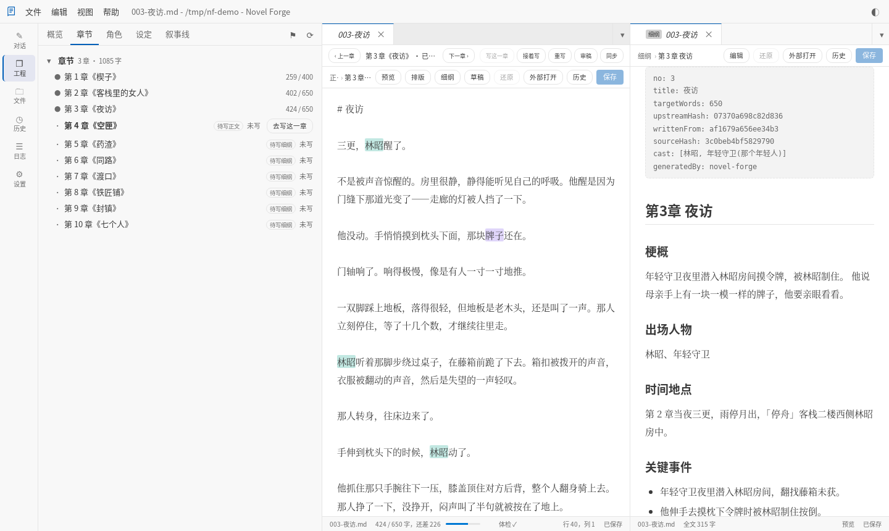
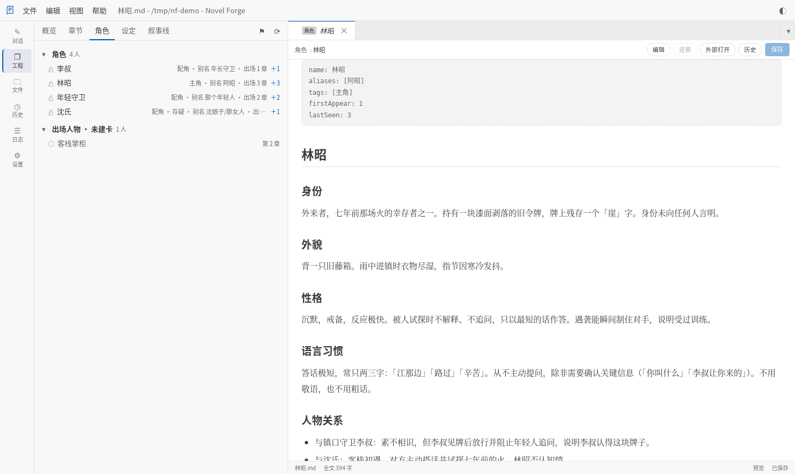
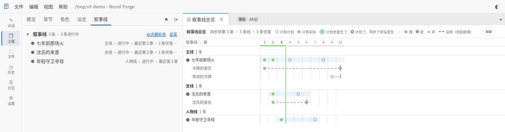
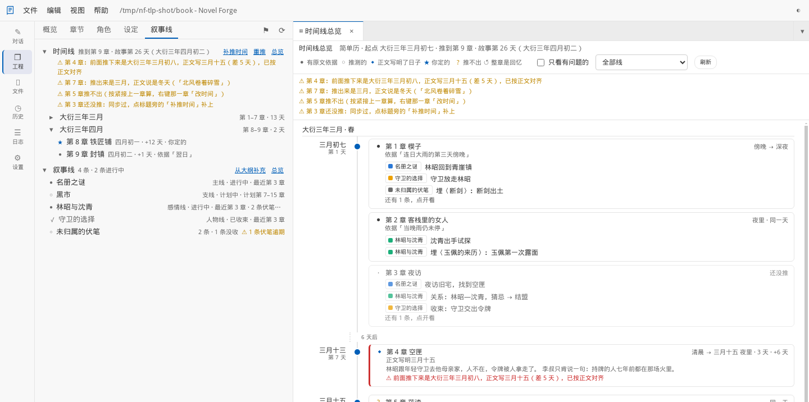
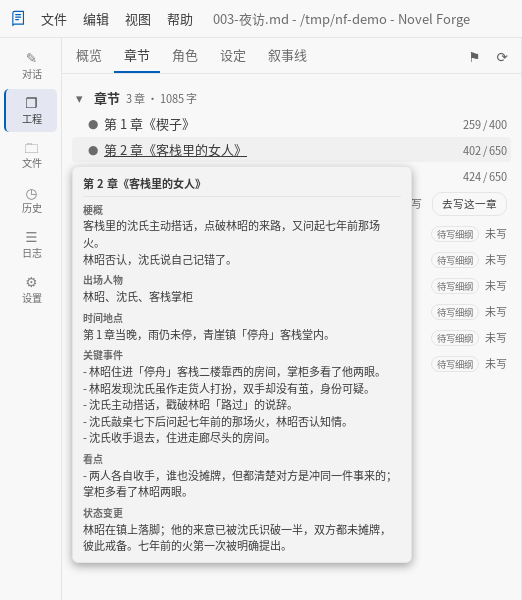

# Novel Forge

**写长篇小说的编辑器，边写边把整本书整理清楚。**

写长篇难的常常不是写不出字，而是管不住：写到几十上百章，谁在哪几章出过场、现在是什么状况，某个门派的规矩当初是怎么定的，哪条伏笔埋了还没收，哪条支线已经二十章没动静——全靠自己记，或者另开一堆笔记手工维护，越写越乱。

Novel Forge 做两件事：

1. **小说编辑器**（重点）——专门为写长篇做的：多标签、正文与细纲左右并排、按这本书的分段格式回车缩进、码字统计、写作体检（禁用词 / 敏感词）、角色名与设定名的补全和高亮、全书查找替换、不会悄悄盖掉改动的保存与历史版本、整本书的存档点。见[编辑器](#编辑器)。
2. **自动整理**——照你写下的正文，把这本书整理成四份档案：**每章细纲**、**角色卡**、**设定**、**剧情线**。写好的书导入之后一键补齐；之后每写完一章点一下「同步」，档案就跟到这一章。档案由机器维护，**不用你动手改**；想改也随时能改，改过的地方机器不会覆盖。见[自动整理](#自动整理)。



所有数据都是工程目录里的普通 Markdown：可以用别的编辑器改，可以用 Git 管，程序挂了数据也还在。

除此之外它也能用 AI 往下写——从一句话展开成架构、大纲、细纲，再一章一章写成正文，见[也能接着写](#也能接着写)。

四种用法共用同一套核心：浏览器里的独立 Web 版（也能用 Docker 放到服务器上）、桌面 App、Android App、VS Code 插件。编辑器在前三种里；插件用的是 VS Code 自己的编辑器。

---

## 快速开始

### 独立 Web 版

```bash
# 方式一：源码直接跑（需要 Bun）
npm install
npm run standalone                                   # 空窗口；上次没关文件夹则恢复
npm run standalone -- sample-novel                   # 打开该目录
npm run standalone -- sample-novel --no-open --port 4000
npm run standalone -- init [目录]                    # 终端交互式初始化（缺省才是当前目录）

# 方式二：编译成单文件可执行
npm run dist                                         # 产出 dist/novelforge（当前平台）
./dist/novelforge sample-novel

# 方式三：npm 包
npm i -g novel-forge && novelforge
```

服务缺省只绑定 `127.0.0.1`、无鉴权，只服务本机；WebSocket 额外校验 `Origin`，挡住恶意网页跨源写入。配置与 API Key 存在 `~/.novelforge/config.json` / `secrets.json`。

页面是一个 VS Code 式的工作台：左边活动栏切「对话 / 工程 / 文件 / 版本 / 历史 / 日志 / 设置」，右边是编辑器，中间的分隔条可拖（双击复位）。不带目录启动时是空窗口（编辑区是欢迎页，见[第一次用](#第一次用)），「文件 → 新建一本书 / 导入写好的书 / 打开文件夹」在同一进程里开工程，不必重启服务。每个浏览器窗口各开一个工程，网址上带着 `?project=<工程目录>`，刷新、收藏都回到这个工程。

### Docker（放到服务器上远程访问）

每次发版都会往 GHCR 推一份独立版镜像，amd64 / arm64 都有：`ghcr.io/noir017/novelforge:latest`（或钉版本 `:X.Y.Z`；`:edge` 是在 CI 里手动点出来的最新构建）。

镜像里服务绑 `0.0.0.0`，别的机器连得进来，所以**必须配访问令牌**（环境变量 `NOVELFORGE_TOKEN`，至少 16 位），没配就拒绝启动。用 docker compose：

```yaml
# docker-compose.yml；同目录的 .env 里写一行 NOVELFORGE_TOKEN=…（可用 openssl rand -hex 24 生成）
services:
  novelforge:
    image: ghcr.io/noir017/novelforge:latest
    restart: unless-stopped
    ports:
      - "3680:3680"
    environment:
      NOVELFORGE_TOKEN: ${NOVELFORGE_TOKEN}
      TZ: Asia/Shanghai
    volumes:
      - ./data:/data
```

```bash
mkdir -p data && sudo chown -R 65532:65532 data   # 镜像以非 root 的 uid 65532 运行
docker compose up -d
```

- **一个卷全装下**：`/data` 是容器里的家目录，配置与 API Key 在 `/data/.novelforge/`，书也放在 `/data` 下（「打开文件夹」从这里开始列）。备份它就够了。
- **用 git 同步书**：镜像里带 git 与 ssh，在容器里直接用，例如 `docker compose exec novelforge git -C /data/我的书 pull`（要进 shell 就 `docker compose exec novelforge bash`）。git 的身份（`git config --global user.name …`）记在 `/data/.gitconfig`，SSH 密钥放 `/data/.ssh/`，都在卷里、重建容器不丢。Novel Forge 自己不碰 `.git`——app 里的版本管理是存档点，git 只是你自己的同步工具。
- **登录**：浏览器打开 `http://<服务器>:3680/`，输一次令牌，记住 30 天。换令牌重启之后，旧的登录全部作废。
- **公网要套 HTTPS**：令牌在 http 上是明文传的，直连只适合内网。要经公网访问，就在前面加一层 HTTPS 反代，并且要转发 `Host`（或 `X-Forwarded-Host`）和 WebSocket 升级头（`Upgrade` / `Connection`），不然对话页连不上。
- **MCP**：`claude mcp add --transport http novelforge http://<服务器>:3680/mcp --header "Authorization: Bearer <令牌>"`。
- 不用 Docker 也行：独立版可以用 `--host 0.0.0.0` 绑到别的地址，规则一样，绑非回环地址就必须设 `NOVELFORGE_TOKEN`。只要设了令牌，即使只绑本机也照样要登录。

### 桌面 App（Windows / Linux）

双击就开的普通桌面应用。它是一层纯壳：里面装的就是独立 Web 版的单文件可执行，所以界面、功能、数据落点与独立 Web 版完全一致。

```bash
npm run app:dev      # 开发运行（需要 Rust 工具链）
npm run app:build    # 出安装包（Linux: AppImage / deb，Windows: NSIS）
```

Windows 安装包必须在 Windows 上构建，见 [.github/workflows/app.yml](.github/workflows/app.yml)；细节与已知坑见 [src/shells/desktop/README.md](src/shells/desktop/README.md)。

### Android App

手机上用：装 Release 里的 `NovelForge-<版本>-android-arm64.apk`（arm64 手机，Android 8 起）。界面就是独立 Web 版的那个页面，手机上是窄屏布局。第一次打开选一种用法，之后在返回键弹的菜单里点「服务端设置…」随时换：返回键先一层层收起菜单、弹窗和正文，收完了才弹这个菜单。

- **本机**：服务就跑在手机上，不用另外开电脑。书放在「Documents/NovelForge」（要授「所有文件访问」，文件管理器、同步盘都看得到，卸载 app 也不删）；不授权就放在 app 自己的目录，卸载时一起删。API Key 留在 app 私有目录。用着的时候通知栏挂一条「本机服务在运行」：写一章要几分钟，切到别的 app 也不会断；从最近任务里划掉 app，服务一起关。
- **远程**：连一台已经部署好的服务（上面的 Docker，或用 `--host` 绑出去的独立版），填地址和令牌。书在服务器上，手机只是个窗口。

手机上（浏览器打开同样如此）：导航在底栏，有对话、工程、正文、版本，文件、历史、日志、设置收在「更多」里；标题栏右边的「⋯」是文件 / 编辑 / 视图 / 帮助菜单；返回键先收菜单、弹窗和正文。电脑上右键的地方改成**长按**；电脑上要悬停才看得到的，手指点一下或长按也看得到——点正文里的名字弹一句话（长按打开角色卡 / 设定条目），长按章节行有「细纲速览」，叙事线总览点格子看这一格（长按打开那一章）。还有几处原生的悬停提示（行上的小圆点、时间线卡片上的完整日期）手机上看不到。构建与已知限制见 [src/shells/android/README.md](src/shells/android/README.md)。

### VS Code 插件

```bash
git clone <this-repo> && cd novel-forge
npm install
npm run compile
```

在 VS Code 里打开本仓库，按 `F5` 启动 Extension Development Host（自动打开 `sample-novel/` 示例工程）。命令面板里搜 `Novel:` 能看到全部命令。插件没有内置编辑器，写正文用 VS Code 自己的编辑器；整理与生成的功能都在。

### 第一次用

独立版与桌面版一打开是欢迎页，左边三条路：**新建一本书**、**导入写好的书（txt）**、**打开文件夹**；右边一段「怎么上手」。之后随时从「帮助 → 欢迎页面」再打开它。

**写一本新书**

1. 点「新建一本书…」，填书名（作者可以空着），「放在」缺省是上一本书所在的文件夹，点「选…」可以换。点「新建」，就在那里建一个以书名命名的文件夹，整本书都在里面。
2. 建好之后左边自动切到「工程 → 章节」，点「新建第 1 章」，起个章名（也可以空着），右边打开就能写。`Ctrl` + `S` 保存；写完一章，在「章节」页空白处右键「新建章节文件」接着建下一章。
3. 想让 AI 从一句话起头，跟着对话页输入框上方的主按钮走（见[也能接着写](#也能接着写)）。

**导入一本写好的书**

1. 点「导入写好的书（txt）…」，挑一本 txt（UTF-8 / GBK 都认）。每章开头要有单独一行的章标题，如「第一章 雪夜」「第12章」「楔子」。
2. 表单上先告诉你认出几章、多少字、丢掉了什么（书名简介、卷标题、目录）；书名缺省取文件名。点「导入」，建好一本书，原稿按章切成一章一份放进去，原 txt 不动。认不出章的话改好 txt 里的章标题再来。
3. 要把细纲、角色卡、设定、剧情线整理出来，先配一个模型（下一条），再点对话页的主按钮「从已写正文补齐…」（见[已经写好的书](#已经写好的书导入然后一键补齐)）。

**配模型（可选）**：光用编辑器不需要模型。要整理或生成时，到「设置」页点一个预设添加服务商 → 填 API Key → 点该模型的「测试」（见[配置](#配置)）。之后每写完一章点一下「同步」，档案就跟到这一章。

**已经在用的书**（比如从 Git 拉下来的）用「打开文件夹」；还不是小说工程的文件夹，工程页会给「初始化小说工程」。正文本来就是一章一个文件的，直接放进 `chapters/`（文件名以章号开头，如 `001-雪夜.txt`）。插件版没有欢迎页：打开文件夹后用命令面板 `Novel: 初始化小说工程`。

---

## 编辑器

独立版与桌面版右边是一个专门写小说的编辑器：多标签、两块并排的编辑区、每个文件各记各的撤销、查找替换、不会悄悄盖掉别人改动的保存与历史版本、外观与专注、码字统计、写作体检、名词补全与名词高亮、全书查找替换。插件版用 VS Code 自己的编辑器，这一节说的都是独立版（两边的差别见[与插件版的差异](#与插件版的差异)）。

下面写的快捷键都是 Windows / Linux 的；Mac 上 `Ctrl` 换成 `⌘`、`Alt` 换成 `⌥`（菜单与「快捷键一览」里会直接这样写）。全部快捷键见[快捷键一览](#快捷键一览)，在编辑器里按 `Ctrl` + `/` 也能随时调出来。

### 打开与写

#### 打开文件与标签

- **怎么打开**：在「工程」页点章节、角色卡、设定条目，或在「文件」页点任意文本文件，就在右边打开；产物落盘后也会自动打开写入的那一份。在工程页点章节行，正文开在左边主区、这一章的细纲并排开在右边（还没有细纲就按模板建一份空的七节；上一次在右边开的是草稿，就开这一章的草稿）。
- **能打开什么**：工程目录里、不超过 2 MB 的纯文本——扩展名是 `.md` / `.markdown` / `.txt` / `.json` / `.yml` / `.yaml`，**或者**它本身就是一份章节（数字前缀 + 非二进制扩展名，所以 `001-楔子` 这种无扩展名的章节也打得开）。别的交给系统默认程序；工具栏上的「外部打开」随时可以换成你自己的编辑器。
- **转到（`Ctrl` + `P`，或「文件 → 转到…」）**：不用回工程页翻。页面顶上出来一个输入框，打几个字就跳到一章或一个文件。焦点在左边对话输入框里时也能按；没打开工程时这个键不起作用。
  - **找章**：直接打章号——`12`、`第12章`、`第十二章`、`一百零五` 都行，那一章排第一
  - **找名字**：章节标题、角色名（包括别名）、设定标题、情节大纲 / 文风指南 / 叙事线 / 全文大纲、草稿的文件名。连着的几个字最先，其次是按先后顺序出现的几个字（`林归` 能找到「林昭归来」）；名字里都没有，再按文件名和路径找（打 `第一卷` 列出那一卷的章）
  - 每一条前面标着是什么（章 / 角色 / 设定 / 架构 / 文档 / 草稿），下面一行小字写「第 12 章 · 第一卷 · 3200 字」、角色的别名，或者文件路径；对上的字标了颜色。一次最多列 50 条，多打几个字缩小范围
  - 什么都不打时，先列最近在编辑器里开过的（每本书各记各的，记在浏览器里），再列前几章
  - `↑` `↓` 选，`回车` 打开：章节和在工程页点章节行一样，还没写正文的章开细纲；`Ctrl` + `回车`（或按住 `Ctrl` 点）开在右边第二块编辑区。打开之后光标就在正文里，可以接着写。从这里打开的是普通标签；要去的那一份正好是临时标签的话，它就此固定下来。`Esc` 或点面板外面关掉
- **标签**：没保存的标签带圆点。标签上写去掉扩展名的名字，前面一小格写它是什么——细纲、草稿、角色、设定……（正文不写），同一章的正文、细纲、草稿一眼分得开；还撞名的（比如两卷里各有一个「003-夜访」）后面淡淡写上是哪个目录。鼠标停在标签上看完整路径。
- **临时标签**（缺省开）：在「工程」页、「文件」页**单击**打开的文件，标签名字是斜体的——它是临时的，下一次单击别的文件时就在原位置换成那一个，不会越开越多。在里面打了字、保存了、双击这个标签，或者在那两页**双击**那一行，它就固定下来。改过还没保存的标签永远不会被换掉。生成落盘后自动打开的、点审稿报告引文打开的、章节条上「并排看细纲」打开的，一开始就是普通标签。每块编辑区最多一个临时标签；刷新页面后，原来斜体的那一个还是斜体的。不想要这个行为：「视图 → 单击打开为临时标签」去掉勾（记在浏览器里，不进工程）。
- **标签多了**：在标签条上滚鼠标滚轮就是左右滚，当前那个标签总会自动滚进视野。标签条最右边的「▾」列出两块编辑区里开着的全部文件（没保存的打着 ●；「叙事线总览」「时间线总览」那两个标签也在里面），点一下就切过去；底下还列着最近关掉的几个，点一下重新打开。
- **标签右键**：关闭 / 关闭左侧 / 关闭右侧 / 关闭其它，「移到另一侧」（左边的搬到右边、右边的搬到左边，没保存的内容和撤销记录一起搬过去）、「在文件页中定位」、「复制相对路径」、「重新打开刚关闭的」（左右两块各记各的），临时标签多一项「固定」。重新打开没有快捷键——浏览器不让网页用 `Ctrl` + `Shift` + `T`。
- **工具栏上的路径**写成「细纲 › 第一卷 › 第 3 章 夜访」「角色 › 林晚」这样（章节那一段写的是这一章现在的标题，与章节条、「转到…」一样——改了标题而文件名没跟着变时也对），鼠标停在上面看原始路径；点前面某一级（「细纲」「第一卷」）会在「文件」页定位到那个目录。
- **两块编辑区**：主区放正文，右边第二块放草稿或并排的细纲，各有自己的标签条、工具栏与状态栏，中间的分隔条可以拖、双击复位。保存、关标签这些快捷键作用于**有焦点的那一块**。第二块关掉最后一个标签就整块收起；窄屏（≤900px）放不下并列，它自动藏起来。同一个文件不会同时开在两块里——从另一块打开它（或标签右键「移到另一侧」）会连同没保存的内容与撤销记录一起搬过去。
- **细纲与草稿**：打开的是章节正文时，工具栏多「细纲」「草稿」两个按钮——点「细纲」在右边开这一章的细纲（还没有就按模板建一份），点「草稿」在右边开这一章的草稿（见[章节草稿](#章节草稿)）。之后在工程页点章节，右边跟着开上一次点的那一种。
- **章节条**：打开的是一章的正文或细纲时，编辑区上方多一条：这一章写了多少、走到哪一步，「写这一章 / 接着写 / 重写 / 审稿 / 同步」几颗按钮（按这一章的状态亮哪几颗，说明里写着调用次数），以及「并排看细纲 / 并排看正文」。条上的字数和状态随时是新的，不管左边开着的是哪一页。
- **上一章 / 下一章**：章节条两头的「‹ 上一章」「下一章 ›」，或 `Alt` + `PageUp` / `Alt` + `PageDown`。章节按章号排（文件名开头的数字，与放在哪个卷目录里无关），到头了按钮是灰的。看着正文就翻到相邻那一章的正文，看着细纲就翻细纲；这一份没改过就在原位置换掉，改过了就另开一个标签（改的东西一个字不动）。右边那一块正开着这一章的细纲（或正文）的话，它也跟着翻，光标还留在你按键的那一块。相邻那一章还没写正文、或者还没排细纲时，会直接告诉你，不会打开一个不存在的文件。
- **Markdown 预览**：`.md` 文件的工具栏上有「预览」（或按 `Ctrl` + `Shift` + `V`），再按一下回到编辑；frontmatter 单独框出来，不混进正文。**每个标签各记各的**：切到别的标签再切回来，原来在预览里的还在预览里（滚到哪也记着），刷新页面之后也一样。切换时两边滚到同一处——编辑区顶上那一行，在预览里对应的那一段停在顶上，反过来也一样；切回编辑时光标要是已经不在眼前，就放到眼前第一行的行首，免得一打字又跳回原处。`.txt` 章节没有 Markdown 可预览，按钮不出现，`Ctrl` + `Shift` + `V` 照常是粘贴。

#### 写

- **撤销 / 重做**：`Ctrl` + `Z` 撤销，`Ctrl` + `Y` 或 `Ctrl` + `Shift` + `Z` 重做（「编辑」菜单里的也一样）。每个打开的文件各记各的，切到别的标签再切回来照样退得回去；关掉标签或刷新页面之后从头记。一口气打的字算一步，回车另起一步；用输入法打字时，一次上屏算一步。编辑器替你做的改动——排版、替换、名词补全、「还原」、「用磁盘版本覆盖编辑器」、磁盘上同步进来的新版——也都能一下撤销。
- **`Tab` 缩进**：正文（章节与草稿）一级是两个全角空格，角色卡、细纲、设定这些是两个半角空格。没选中时在光标处插一级；选中几行（哪怕只选了一行里的几个字）按 `Tab`，每行行首加一级，选中的字不会被替换掉；`Shift` + `Tab` 去掉一级。
- **输入法优先**：用输入法打字、拼音还没上屏时，`Tab`、回车、方向键和各种 `Ctrl` 组合键都照常交给输入法，编辑器一个都不抢。

#### 段落与标点

这几样里说的「正文」指章节与草稿；角色卡、细纲、设定这些不算。

- **分段格式**是整本书的设置，三选一：**空行分段**（段与段之间空一行、段首不缩进，网文常见，也是缺省）、**段首缩进**（段首两个全角空格、段与段之间不空行，出版常见）、**缩进加空行**（两样都要）。在「编辑 → 段落格式」里切，当前那项打着 ✓；它记在 `.novelforge/config.md` 开头的 `paragraphStyle` 一行（写 `blank` / `indent` / `both`，或者直接写中文「空行分段」「段首缩进」「缩进加空行」都认）。切换只改这一行，已经写好的正文一个字不动——想把它们排成新格式，用下面的「一键排版」。
- **回车**按分段格式另起一段：空行分段就空一行，段首缩进就换行再缩进两格。光标后面跟着的空格会顺手删掉；在只有空白的行上回车只换行、不缩进（连按回车不会堆出一串缩进行）；在段首回车是把这一段整个往下推一行。`Shift` + `回车` 只换行、不缩进——写诗、写信、短句一行一行排时用。角色卡这些 Markdown 里回车沿用上一行的缩进，列表（`- `、`* `、`1. `）会接着往下写，在空的列表项上回车就结束列表。
- **段落快捷键**（所有文件都能用，空行不算一段；每个都能一下撤销）：
  - `Alt` + `↑` / `↓`：光标所在这一段（选中了就是选中的那几行）与上 / 下一段对调，中间的空行不动
  - `Shift` + `Alt` + `↓` / `↑`：把这一段复制一份放在下面 / 上面（正文按分段格式隔开）
  - `Ctrl` + `Shift` + `K`：删掉这一段（空行分段时连带删掉多出来的那个空行）
  - `Ctrl` + `回车`：不管光标在这一段的哪里，都在它下面另起一段
- **成对符号**：打出 “ ‘ 「 『 （ 《 【 〈 的左半边，右半边自动补上，光标停在中间；选中一段字再打左半边，就把这段字包起来。紧挨着自动补上的右半边再打一次右半边会直接跳过去，不会多出一个（输入法常常自己交替出 “ ”，这样正好对得上）；刚补完还没打字就退格，左右一起删。只在光标后面是行尾、空白或标点时才补——后面紧跟着正文时补了反而要回头删。半角括号不补。不想要可以在「编辑 → 成对符号自动补全」关掉（记在浏览器里，不进工程）。
- **一键排版**：工具栏「排版」按钮（只在正文上出现，挨着「预览」），或者「编辑 → 一键排版」。按这本书的分段格式把正文重排一遍：每个非空行是一段，去掉首尾多余的空格（半角、全角、制表符都算），段首该缩进就缩进，段与段之间原来空了几行都收成一种；`#` 开头的标题行和只有符号的分隔行（`* * *`、`※`、`◇◇◇`……）不缩进；开头的 frontmatter 原样留着。选中了几行就只排这几行，否则排整章。做完会说改了几处，一下撤销就回去。
- **半角标点转全角**：「编辑 → 半角标点转全角」。只在中文里转——前一个字是汉字或中文标点时，`,` `.` `?` `!` `:` `;` 换成全角；`3.14`、`1,000`、英文句子、`config.md` 这种文件名、网址、代码都不碰。`...` 和 `。。。` 换成 `……`，汉字之间的 `--` 换成 `——`，括号里有汉字（或者像 `(1)第一条` 这样挨着汉字）时一对一起换成全角；直双引号只在同一行里成对、中间有汉字时才换成 “”，单引号不动（英文的 `don't` 会把配对搅乱）。同样是选中几行就只转这几行。

#### 章节草稿

每一章都可以有一块**和正文并排的涂改区**：放废弃的段落、备选的写法、给自己的批注。草稿是普通文本文件，跟着工程走、可 Git、可手改，和别的东西一样。

在章节上右键点「新建草稿」（已有草稿时显示「打开草稿」），或者在内置编辑器里打开正文后点工具栏的「草稿」按钮。**首次点的时候才创建**——不会给一个已经二百章的工程凭空撒二百个空文件。

草稿存在工程根的 `drafts/` 下，路径镜像章节在 `chapters/` 之下的那一段，文件名（含扩展名）原样沿用：

```
chapters/001-楔子.md        →  drafts/001-楔子.md
chapters/第二卷/003-夜访.md  →  drafts/第二卷/003-夜访.md
chapters/005-手记.txt       →  drafts/005-手记.txt
```

几条要记住的：

- **草稿不进 LLM 上下文。** 装配器任何阶段都不读它——想让模型看见，就在 `@ 引用` 里手动挑（草稿单列一组，只列已经建过的）。
- **绝不覆盖。** 第二次点「打开草稿」只是打开，不会把你写的东西换成模板。
- **草稿跟着章节走。** 章节改名或移动，草稿一并搬过去；如果新位置已经有草稿了，两份都留着并提示你自己去合。
- **删章节不删草稿。** 确认框里会说明草稿留在哪儿。
- 草稿**不是**可管理区：它不出现在工程页的树上，也不能在界面上重命名/移动/删除——它的位置由章节路径推导，直接改它只会让下次点「打开草稿」建出一个新的空文件。要清理就在文件管理器里删。
- 草稿字数不计入章节字数，也不影响同步状态。

#### 文件页（资源管理器）

活动栏第三个页签，独立版专属——插件形态里这件事由 VS Code 自己的资源管理器承担。

它列的是**工程目录的原样结构**，与「工程」页那个整理过的视图不同：这里一个文件都不藏，**包括 `.novelforge/` 这类点开头的文件夹**。细纲与全文大纲（`summaries/`）、会话记录（`sessions/`）、历史版本（`history/`）、`project.json`、`style.md` 都在里面——会话、`project.json` 这类工程页上不列的文件，想手改只有这里。

- 点文件夹展开/折叠，按需加载（几百章的工程不会一进来就扫全盘）；展开状态记在浏览器里，刷新后还在
- 单击文本文件在右侧编辑器里开成**临时标签**（见下面「内置编辑器」），双击开成正常标签；图片、压缩包这类打不开的文件名字置灰，点了交系统默认程序
- 编辑器里当前编辑的那个文件在树上高亮，工具栏的 ◎ 可以定位到它；在编辑器里点路径上的某一级目录、或在标签上右键「在文件页中定位」，会切到这一页、展开到它，并用虚线框标出那一行
- 右键：展开/折叠、在系统中打开、复制相对路径

这一页**只看不改**：新建、改名、删除仍然在「工程」页做（那里的操作锁在章节/角色/设定三个区内，删除也是搬进回收站而非真删）。

### 查找、保存与版本

#### 查找替换

在**这一份文件**里找；要在整本书里找，用下面的[全书查找替换](#全书查找替换)。

- `Ctrl` + `F` 打开查找条（选中了一行之内的几个字时直接填进去），`Ctrl` + `H` 连替换那一行一起打开；「编辑」菜单里也有「查找」「替换」。每块编辑区各有一条，只找这一块里当前的文件
- 边打字边从光标往后找，所有找到的地方都标上底色，当前这一处颜色更深，条上写着「第几处 / 一共几处」
- `Enter` 或 `F3` 下一处，`Shift` + `Enter` 或 `Shift` + `F3` 上一处，到头了绕回来；`Esc` 关掉，光标回到正文里刚找到的那一处
- 「Aa」区分大小写，「.*」按正则表达式找（写错了条上会说一句）；按正则替换时可以用 `$1`、`$2` 引用括号里的那一段
- 「替换」换掉当前这一处、跳到下一处（光标还不在某一处上时，第一下只是选中它，看清了再按）；在替换框里按 `Enter` 也一样。「全部替换」一次换完并告诉你换了几处，`Ctrl` + `Z` 一下全部退回
- 焦点在左侧对话输入框里时，`Ctrl` + `F` 还是浏览器自己的查找；在预览里按会先切回编辑。超过 30 万字的文件照样能查能换，只是不画底色

#### 全书查找替换

`Ctrl` + `Shift` + `F`，或「编辑 → 全书查找替换…」；`Ctrl` + `Shift` + `H` 直接把光标放进替换框。在整本书里一起找、一起换，比如「把人名林晚全书改成林婉」。面板占的是左边侧栏的位置（和 VS Code 的「搜索」一样），右边的正文一点都不挡；点左边活动栏上任一页签、面板上的 ×、或按 `Esc` 收起，结果留着，再打开还在。

- **找**：打字停一下就开始搜；「Aa」「.*」两颗开关和单个文件的查找条是同一套（正则里也能用 `$1`）。下面一排勾选**在哪找**：正文（缺省只勾这一项）、细纲、草稿、角色卡、设定条目、其他创作文件（情节大纲、小说配置、故事前提、世界观、文风指南、叙事线、全文大纲）。编辑区里选着一行之内的几个字时按 `Ctrl` + `Shift` + `F`，直接拿它来搜
- **结果**按正文、细纲……分组，一份文件一行：「第 3 章 夜访」「细纲 · 第 3 章 夜访」「角色 · 林晚」这样的称呼和一共几处，下面每一处一行上下文，找到的字标着颜色。点一处就在右边打开那份文件、选中那几个字（那份文件的查找条也亮着同一个词，`F3` 接着往下跳）；点文件那一行收起 / 展开
- **搜的是磁盘上存着的内容**：编辑器里改了还没保存的文件，结果上标着「未保存」——列的是磁盘上那一份，替换时也会跳过它
- 一次最多列 1000 处，多了会说「只列了前 1000 处」、搜到哪一份就停了；多打几个字缩小范围。超过 2 MB 的文件不搜，也会说出来。搜得慢的时候点「停止」
- **换**：填好替换框，点「**预览替换**」——每一处都画成「旧的划掉、新的跟在后面」，每一处、每个文件前面都有勾，缺省全勾；「林晚霞」这种不该换的就勾掉。确认之后点「**替换所选**」，按钮先变成「再点一下：替换 N 个文件 M 处」，再点一下才真的换
- 换完会告诉你**换了几个文件几处、跳过了哪些、为什么**：编辑器里改了没保存的跳过（先保存或放弃修改，再换一次）；预览之后在别处改过的跳过（不会拿预览时的内容盖掉新改的），重新预览一次就行。然后自动再搜一遍，列出还剩下的
- **每个改过的文件都可以在「版本」里找回替换前那一版**（打开那份文件，点工具栏上的「历史」或活动栏的「版本」）——换之前每一份都先存了一版。跨好几个文件的替换**没有一步撤销**，历史版本就是退路。已经开在编辑器里、没改过的标签会自动换成新内容
- **不会动的东西**：细纲、角色卡、设定开头那段 frontmatter 里程序自己记的账（指纹、章号、字数、状态……）不搜也不换——搜「3」换成「三」不会把它们弄坏；名字、别名、标题、出场人物照样换。细纲的「关键事件」、角色卡的「当前状态」这些小节的**标题行**也不换（换了程序就认不出那一节了），情节大纲里「第1–5章」那一截同理
- **会不会让章节挂 ⟳**：细纲和正文在同一次替换里**都**改了（全书改名就是这样），那一章不会因此挂 ⟳、同步过的也不会退回「待同步」；只改了细纲、正文没跟着改的，正文会挂 ⟳；只改了正文、细纲没跟着改的同步过的章，回到「待同步」；改了大纲、细纲没跟着改的，细纲挂 ⟳——这几种换完都会在汇总里列出是哪几章
- **角色改名**：角色卡里的名字或别名换了，文件名不会跟着改（`林晚.md` 还叫 `林晚.md`）——认人看的是卡里的名字和别名，不看文件名；汇总里会提一句，想改文件名就在工程页右键「重命名」。出场统计、设定名录这些会按新的名字重新算

#### 保存、冲突与历史版本

- **保存**：`Ctrl` + `S`（或工具栏「保存」、「文件 → 保存」），存的是有焦点那一块的当前文件；「文件 → 全部保存」存所有改过的。工具栏「还原」丢弃修改、重新读盘（有修改时先问一句，放弃之后还能 `Ctrl` + `Z` 撤销回来）。
- **保存状态看状态栏**：右下角那一格写着「● 未保存」→「保存中…」→「已保存 14:32」（这次打开页面以来最后一次存成的时刻）。存成了不弹提示条；撞上冲突、出错照样弹。点了保存 10 秒还没回音（多半是和服务器断线了，页面顶上会出现红色的重连条），这一格会说「还没收到回音，连上后会自动发出」——编辑器里的内容一直都在，连上之后那次保存自动发出去，整个页面的状态也会重放一遍。
- **自动保存**（缺省关）：「文件 → 自动保存」，开着时打 ✓，状态栏上多一枚「自动保存」。开着时：停笔 2 秒（用输入法打字、拼音还没上屏不算停笔）就存当前这一份；切到别的标签时存刚离开的那一份；切到别的窗口、或者把浏览器页签藏到后面时，所有改过的都存。这个开关记在浏览器里，不进工程。
  - 它照样带着「磁盘上是不是还是那一份」的核对：撞上冲突就**停下这一份的自动保存**（那一枚写「自动保存已暂停」），等你在冲突条上选了再接着存，绝不替你强制覆盖；磁盘上已经没有了的文件也不替你重建
  - **注意**：正文一保存，已经同步的章就会回到「待同步」（同步记的是正文的指纹）。开着自动保存时，在同步过的章里改一个字，停笔两秒它就回到「待同步」了——想先改着看看、不急着动同步状态的话，先把自动保存关掉
- **关标签时问一句**：有未保存修改的标签关掉之前（标签上的 ×、中键、`Ctrl` + `W`、「文件 → 关闭编辑器」），会问「保存 / 不保存 / 取消」。选「保存」要等这一份真的存成了才关；撞上冲突、出错就不关，冲突条留着让你取舍。一次关好几个（右键「关闭其它 / 左侧 / 右侧」）时，没保存的那几份合在一个对话框里问一次，列出是哪几份：「全部保存 / 全部不保存 / 取消」。对话框里 `Enter` 选主按钮，`Esc` 取消。`Ctrl` + `W` 在浏览器里多半被浏览器拿去关整个网页（有没保存的内容时浏览器会先问），桌面版里才是关标签。
- **刷新与离开页面**：刷新页面不丢未保存的修改（存在浏览器本地；磁盘上的内容变过就丢弃并提示，不拿旧的盖新的）。带着未保存内容关掉浏览器页签或刷新时，浏览器会先问一句。
- **磁盘上的改动会同步进来**：同步写回细纲、批量写章、外部 agent 改了文件、你在别的编辑器或 git 里动了文件，开着的标签会跟着变——
  - 没改过的标签：直接换成磁盘上的新版，不切标签、不抢光标；正看着的那一份状态栏会说「磁盘上有新版本，已载入」，`Ctrl` + `Z` 可以退回换之前的样子
  - 改过的标签：你的修改一个字不动，标签上挂一个「!」，切过去能看到冲突条，处理办法见下一条
  - 磁盘上已经没有了（被删、被改名）：标签名划掉、挂红色「!」，冲突条上说「磁盘上已经没有这个文件」。编辑器里的内容还在；这时按保存，会先问你要不要在原路径重新建一份（如果是在别处改了名，新名字那边已经有一份，重建会多出一份）
  - 什么时候查：每次磁盘上有变动、以及你切回这个窗口的时候
- **不静默覆盖**：保存带内容指纹的乐观锁。文件在你编辑期间被别处改过（你在别的编辑器里改了、或者插件写入了内容），保存会被拒绝，冲突条上给三个选择——**「对比合并…」**（排在第一个）：左边磁盘上的、右边编辑器里的，逐处挑用哪边、结果格可以手改，点「放回编辑器」之后编辑区换成挑出来的那一份（一下撤销就回去），冲突条收起；这时它仍是未保存的，照常 `Ctrl` + `S` 就行，不必强制保存（开着自动保存的话，因为撞冲突停下的自动保存也接着走；之后磁盘上再变，照样会提醒你）。或者整份二选一：「用磁盘版本覆盖编辑器」「用编辑器内容强制保存」（还会再确认一次）。磁盘上已经没有这个文件时没有可合并的，「对比合并…」不出现。同一个工程开在两个浏览器窗口里、两边都在改同一份文件时也一样：一边存了，另一边改过的标签挂冲突条，不会拿着旧的那份把它盖掉。
- **历史版本**：每次覆盖一份已有的稿子之前——编辑器里保存、重写或修稿落盘、同步写回细纲、全书替换、外部 agent 的 `edit`——磁盘上的旧内容会先存成一版，放在 `.novelforge/history/` 里（见[目录结构](#目录结构)）。左边活动栏的「**版本**」（或工具栏「历史」、「文件 → 历史版本…」）列出编辑区当前这份文件的时间线，新的在前：
  - 最上面「**还没保存的改动**」（编辑器里改了还没存时才有）；然后是存下的各版（「3 分钟前 · 14:32」、多少字、比现在多或少几个字），和这份文件在各[存档点](#存档点)里的样子（◆ 手动、◇ 自动，带备注；几个存档点里它一字没动就只列一次）
  - **点一行，编辑区里马上开「对比」标签**：左边那一版、右边现在（编辑器里的，没保存的也算），按段比，一段里改了哪几个字也标出来（删的红、加的绿）；没改的段落折起来，点开再看。顶上「上一处 / 下一处」跳着看；只差缩进、空行时会照实说「只有空白不同」。对比标签只有一个，点别的一行就换内容；关掉它回到那份文件
  - 每处改动旁边「**用回这一处**」把编辑区里那一处换回左边那样；顶上「**恢复整份**」把编辑区整个换成那一版。都**不写盘**：换进来之后是未保存的，一下撤销就回去，存不存由你。放回之前，磁盘上现在那一份会先存成一版（与最近一版一样就不重复存），所以放回的内容存下去之后，被它盖掉的那一版照样在列表里。**开着自动保存时，放回的内容会很快写回磁盘**——停笔 2 秒就存；存之前那一版已经进了历史，可以再恢复回来
  - 右键一行：「跟后一版比」看那一次改了什么（两边都是存下的，只能看）；「恢复整份到编辑区」
  - 「版本」页**最上面是「全书改动」**（像 VS Code 的「源代码管理」）：跟一个[存档点](#存档点)比，之后全书改过、新建、删掉的文件按章节 / 细纲 / 角色卡 / 设定……分组列出来，带字数差。缺省跟最近一个**手动**存的存档点比（自动的在批量动作之前都存，太密），下拉可以换。点一份同样在编辑区开对比标签（没开着的先开成临时标签）；之后删掉的只能看。存盘之后列表跟着变。退回不在这里——要整份退回去，用存档点弹窗
  - 「**＋**」（现在存一版）把磁盘上**现在**这一份先存下来（编辑器里还没保存的修改不在里面——要留住它们，保存就行，保存时被覆盖的旧内容同样会存一版）
  - 只给工程里的稿子存：章节、草稿、细纲、角色卡、设定、架构三件、文风、叙事线、全文大纲、敏感词表；工程根下的随手记、`README` 这些不存，「历史」按钮也是灰的
  - 不会存出几百份：与最近一版一字不差的不存；最近一版不到 10 分钟、而且这次只是零星小改（300 字以内）的也不存——所以自动保存、边写边存都只会隔一阵子留一版；整章重写、修稿、一键排版、同步这种大改总是存。每份文件最多留最近 50 版，再多就删掉最旧的——这些是程序自己另存的副本，不是你的文件，删它们和「删除一律进回收站」那条不冲突（你的文件一个字节都没动）
  - 第一次存的时候会在 `.novelforge/history/` 里放一个 `.gitignore`（内容是 `*`），Git 默认不收这些快照；想连历史版本一起提交，删掉它就行，之后不会再补回来
  - 存快照出了问题（磁盘满了之类）只记一条日志，保存照常进行
  - 插件版没有「版本」这一页，但快照照样会存：在 VS Code 的资源管理器里打开 `.novelforge/history/<那份文件的路径>/` 就能看到按时间命名的各版

#### 存档点

工程页顶上页签条最右边、刷新旁边的 ⚑（独立版也可以从「文件 → 存档点…」打开）管**整本书**的版本：把某一刻全书的样子存成一个点，之后随时看跟现在比改了什么，整本或单份退回去。[历史版本](#保存冲突与历史版本)管的是一份文件被覆盖之前的那一版；批量写了二十章、全书替换改了几十份，一份一份找回去不现实，就用存档点。

- **存**：弹窗上面写一句备注（可以空着，比如「第一卷写完」），点「存一个存档点」。**批量动作之前会自动存一个**——批量写章、补齐架构、拆细纲、全书替换、按目录整理设定、批量展开设定、导入原稿、从已写正文补齐、立即同步、从正文补记叙事线、补推 / 重推故事时间，你点了「开始」之后、第一个文件写下去之前。跟最近一个存档点一模一样时不另存。自动存不下（比如磁盘满了）只在日志里记一条，不挡那个批量动作。
- **存了什么**：章节、草稿、细纲、角色卡、设定、架构、文风、叙事线、全文大纲、写作技能、敏感词表（与历史版本同一批）；会话、日志库、回收站、历史版本不存。单份超过 2 MB 的不存，列表上会说。**同样的内容只存一份**：第二个存档点只多存这期间改过的那几份，存几十个也占不了多少地方。
- **看**：一个存档点一行——时间、手动还是自动、备注、那时正文几章多少字。点「跟现在比」分三组列出**改过的**、**之后删掉的**、**之后新建的**，每份带当时与现在的字数。独立版与桌面版每份还有「对比」：弹窗关掉，编辑区里开「对比」标签，左边存档点里的、右边现在的，可以一处一处用回（只进编辑区，存不存由你，同[历史版本](#保存冲突与历史版本)；插件版没有这一项）。平时不想开弹窗，左边活动栏「版本」页最上面的「全书改动」就是跟存档点比的结果。
- **退回**：「退回这一份」，或底部的「整本退回」，都要点两下。退回之前**先自动存一个「退回到 … 之前」**——退回本身也能撤回；被盖掉的每一份另外也在它自己的「历史」里留了一版。存档点之后新建的文件缺省不动，勾上「也把存档点之后新建的 N 份搬进回收站」才搬（进 `.trash/`，不真删）。编辑器里有没保存修改的文件、弹窗打开之后别处又改过的文件会跳过，提示里逐份说出来。有任务在跑时（比如批量写章还没写完）不让退回。
- **退回是原样的**：每份文件一个字节不差地回到当时，细纲里记的指纹也一起回到当时——整本退回之后，哪章待写、哪章挂 ⟳，都和那时一模一样。只退回一份细纲、正文没跟着退时，那一章可能显示「同步之后正文改过」，那是实情。
- **留多少**：手动存的一直留着；自动存的只留最近 30 个，更早的自动删掉。想留住某个自动存档点，点「留住…」写一句备注，它就变成手动的。
- 存档点在 `.novelforge/checkpoints/` 里（第一次存时放一个 `.gitignore`，内容是 `*`，Git 默认不收）。里面是一堆按内容指纹命名的文件，不是给人直接看的，要看、要找回都走这个弹窗。**和 Git 不冲突**：Novel Forge 不碰 `.git`，你照样可以用 Git 同步、备份整个工程。

### 外观、统计与体检

#### 外观与专注

标题栏「视图」菜单里的「外观」「专注」两组。这些设置都记在浏览器里，不进工程，换一本书也还是这样。

- **字号**：光标在编辑区里时按 `Ctrl` + `=` 放大、`Ctrl` + `-` 缩小、`Ctrl` + `0` 还原（缺省 15，最小 12、最大 32）；「视图 → 放大字号 / 缩小字号 / 还原字号」也一样。光标在别处（左边的对话框、页面空白处）时这几个键还是浏览器自己的整页缩放。
- **外观设置**：「视图 → 外观设置…」在右上角开一个小面板，改了当场就能看见，不用点确定：
  - **正文字体**：宋体（缺省）、黑体、楷体、仿宋、跟随系统。用的是你电脑上装的字体——没装的会退回到同类的字体（装了「霞鹜文楷」的话，楷体用的就是它）
  - **字号**、**行距**（拖滑块）
  - **版心宽度**：一行最多放多少字（30 / 35 / 40 / 45 / 50 / 60 / 70 字），屏幕宽的时候那一栏放在中间，读起来不用左右甩头；「铺满」（缺省）就是占满编辑区。预览也跟着同一套字体、字号、行距和版心
  - **主题**：深色、浅色、护眼。护眼是米黄底、深棕字，整个界面一起换（标题栏右上角那颗按钮也能切，按一下换下一套：深色 → 浅色 → 护眼）
  - 没有单独的「段间距」：空行分段时段与段之间就是那一行空行（跟着行距变），段首缩进的格式本来就不空行
  - 「恢复默认」把字体、字号、行距、版心放回缺省，主题不动。`Esc` 或「关闭」收起面板
- **专注模式**（`F8`，或「视图 → 专注模式」）：只留正文——左边的侧栏、标签条、工具栏、章节条都藏起来，底下的状态栏淡成一行（鼠标移上去才看清；字数那一格照样点得开码字统计），标题栏只剩菜单。左右两块编辑区都开着时只专注你正在写的那一块。冲突提醒、查找条、对比标签、全书查找替换照样会出来。`Esc` 或再按 `F8` 出来（码字统计、外观面板、查找条这些开着时，`Esc` 先收它们）；刷新页面后还在专注模式里。
- **全屏**：「视图 → 全屏」，整个页面占满屏幕，`Esc` 退出（浏览器自己的 `F11` 也行）。浏览器不支持时这一项是灰的。桌面版在 Linux 上是真的全屏；在 Windows 上目前只是把页面撑满窗口、窗口本身不会变成全屏，那时用窗口的「最大化」加专注模式代替。
- **打字机滚动**（「视图 → 打字机滚动」）：光标所在那一行始终停在编辑区中间附近——打字、回车、方向键移动之后自动滚过去，写到最后一行也一样，眼睛不用一直往屏幕底下追。用输入法打字时等字上屏了才滚；用鼠标滚轮往上翻看前文时不会把你拽回来，接着打字才回到光标那里。
- **段落聚焦**（「视图 → 段落聚焦」）：正文里光标所在的那一段照常显示，其余的段落变淡。按这本书的分段格式认哪里是一段：空行分段就是空行隔开的一块，段首缩进就是从有缩进的那一行起。只对正文（章节与草稿）起作用；超过 30 万字的文件不做（整篇照常显示）。

#### 码字统计

底部状态栏从左到右是：文件名、字数、写作体检（见下一节）、行列位置（在预览里写「预览」）、保存状态。字数那一格就是码字统计：

- 平时写「全文 3,120 字」；选中一段时写「选中 120 字 / 全文 3,120 字」。数法与工程页一样：中文一个字算一个，英文一个词算一个，标点和空白不算；章节开头那行 `# 标题` 也不算。字符数（连标点空白一起）在鼠标停上去的提示里
- 开着某一章的**正文**时，写成「3,120 / 4,000 字，还差 880」，后面一条细细的进度条，写到八成换成绿色（这一章算写够了的线），超了就写「超出 120」。目标就是写正文时用的那个数：细纲里写的目标字数，没写就是小说配置里的每章字数，两样都没有就不显示。字数跟着你打字当场变，不用先保存。细纲、草稿、角色卡这些不显示目标
- **点一下这一格**弹出码字统计：本章字数与目标、**本次码字**（从打开这个页面起你码了多少字、写了多久、每小时多少字）、**今日码字**（这本书今天一共码了多少）、本次按文件分开的明细，还有「重新开始计时」。`Esc` 或点别处收起
- **怎么才算码字**：只算你亲手打的字——键盘打的、输入法上屏的、名词补全里挑了补上的都算，退格删掉的会扣回去；粘贴、一键排版、查找替换、对比合并、恢复历史版本、磁盘上同步进来的新内容都不算。撤销跟着那一步走：撤销自己刚打的字，那几个字就扣回去；撤销一次粘贴，码字数不动
- **时长只算在写的时候**：停笔超过 2 分钟，中间那段不计时，去倒杯水回来速度不会被拉低。写够 1 分钟才报速度
- **今日码字**记在浏览器里（每本书各记各的），刷新页面、同时开好几个窗口都接着累计，不会重复算，也不会互相盖掉；过了半夜就从零开始算新的一天。它不往工程目录里写——换一台电脑、清了浏览器数据就没了。浏览器不让记的时候只算这一页
- 「视图 → 统计」里选状态栏上还显示哪几项：「距目标」（缺省开）、「本次码字」「今日码字」（缺省关），开着时字数后面跟着「· 本次 +356 字 · 今日 1,820 字」；「视图 → 重新开始计时」让本次码字从现在起重新算（今日的不受影响）。这几个开关记在浏览器里，不进工程

#### 写作体检与名词补全

**写作体检**（只看正文：章节与草稿）：写的时候把这本书不该用的词直接标在正文里，状态栏上一格告诉你一共几处。**不调模型、不花钱**，只是按词表在正文里找字，也不会替你改字。

- **标出来的四样**，样子各不相同（深色、浅色、护眼三套主题下都看得清）：
  - **敏感词**（实线下划线加一层淡底色）：你自己的敏感词表里的词，见下面。英文不分大小写
  - **禁用词**（红色波浪线）：文风指南里「禁用词表」那一节括起来的词、小说配置「全局要求」里写着禁止的词、古代 / 修真这类题材里不该出现的现代说法（能量、神经、频率……）——**与写正文时模型写完之后数的是同一份**，在这里标出来的，就是生成时会提醒你「用到了这本书不该用的词」的那几个
  - **比喻词**（黄色波浪线）：「仿佛」「犹如」「宛如」「如同」……全章合计超过 3 次（写正文时给模型定的上限）才标，没超不标
  - **英文缩写**（蓝色点线）：PTSD、CPU 这种两个以上大写字母的缩写，只是提醒——都市、科幻里的 CEO、AI 是正常的，故事的年代用不上才改
- **状态栏「体检」那一格**：「体检 3」是一共 3 处（比喻词算超出的那几个），没问题时写「体检 ✓」；开着的不是正文时不显示。点一下弹出体检面板：按类列出命中的词和次数，**点一个词就跳到它在正文里的位置并选中**，再点跳到下一处（面板上写着「2/5」），到底了从头再来。`Esc` 或点别处收起
- 打字时当场跟着变；几万字的章节也不卡（两万字以上隔一小会儿才重查一次，已经标着的会跟着字挪）。用输入法打字、拼音还没上屏的时候不查——拼音字母不会被当成英文敏感词
- 「视图」菜单「统计」后面那一组：「**体检高亮**」（缺省开，关掉之后正文里不画，状态栏那一格照样数）、「**状态栏显示体检**」（缺省开）、「**编辑敏感词表…**」。两个开关记在浏览器里，不进工程
- 与查找、段落聚焦同时开着时互不干扰：查找画的是底色，体检画的是下划线，段落聚焦管的是字的深浅。超过 30 万字的文件不画（面板里照样数、照样跳）

**敏感词表**：发布平台不让出现的词，你自己维护，放在 `.novelforge/sensitive.txt`。体检面板底下或「视图 → 编辑敏感词表…」打开它——还没有的话先建一份带说明的模板（不会盖掉已有的）。格式：

```text
# 井号开头的行是注释，空行不算
某平台
赌博 => 博戏
Free Money
```

- 一行一个词；`词 => 替换词` 给出建议的替换（只认半角的 `=>`）。英文不分大小写，全角字母当半角
- 有替换词的，体检面板里那一行多两颗按钮：「**替换本处**」换掉选中的那一处、接着选中下一处（还没选中时第一下只是选中，看清了再按）；「**全部替换**」把这份文件里的都换掉。两样都只改编辑区里这一份、一下 `Ctrl` + `Z` 就退回，存不存由你；不动别的文件
- 写错的行（`=>` 前面没有词、后面没有替换词、一行两个 `=>`、一个词超过 32 个字、和前面某一行重复）会跳过，不报错，面板里会说「第 N 行没看懂」，鼠标停上去看为什么
- 保存它和保存别的文件一样（会留历史版本）；存了之后体检马上按新词表标
- **现在只用于编辑器里的体检**：写正文时模型看不到这份词表，也不会替你避开它们；它也不在细纲、正文的指纹链上，改了它不会让任何一章挂 ⟳

**名词补全**（`Alt` + `/`，或「视图 → 名词补全」）：写到角色名、地名、门派、法宝这些名字时按一下，光标下面弹出一个小框，挑一个就补上，不用每次都把「太上忘情诀」打全，也不怕把「沈怀山」打成「沈怀珊」。

- **名字从哪来**：角色卡的名字和别名、设定条目的标题和关键词，还有设定名录里「出现过 · 未建条目」的那些名字。不调模型、不花钱。新建或改了角色卡、设定，下一次弹出来就是新的
- **列哪些**：光标前已经打了几个字（比如「沈怀」），就只列以它开头的名字；什么都没打、或者打的字对不上任何名字时，列出全部，**这一章里刚出现过的排在最前面**
- 每一行写着名字（打过的字标了颜色）、类型（角色，或者设定所在的目录：地点、门派、物品……）和卡或条目里那一句简介。对上的是别名时写成「老沈 → 沈怀山」，选它插进去的是「老沈」——你打的就是这个叫法
- `↑` `↓` 选，`回车` 或 `Tab` 插入：已经打的那几个字换成整个名字，光标停在名字后面，`Ctrl` + `Z` 一下就撤回。`Esc` 收起。框开着时接着打字它会跟着筛；打了标点、点了别处、切了标签、滚动页面时收起
- **边打边弹**（缺省关）：「视图 → 边打边弹名词补全」打上勾以后不用按键——打出某个名字的**头两个字**、还没打完整时，框自己弹出来。这时**回车照常换段**（框顺手收起），要插入名字按 `Tab`；接着打别的字它就自己收起。名字已经打完整了、只打了一个字时不弹（不然「林」「沈」这种常用字一打就弹）。这个开关记在浏览器里，不进工程
- 用输入法打字、拼音还没上屏时不弹，也不抢任何键
- 只在正文、草稿、细纲、角色卡、设定条目、情节大纲和叙事线里有；小说配置、故事前提、世界观、文风、敏感词表这些不弹
- 补全插进去的字算你码的字（「本次 / 今日码字」照算），撤销了就扣回去

**名词高亮**（缺省开，「视图 → 名词高亮」开关）：正文里出现的角色名、设定名标出来，一眼看得出这一段提到了谁、哪里。名字和名词补全是同一份（角色卡的名字和别名、设定条目的标题和关键词、设定名录里「出现过 · 未建条目」的名字），同样不调模型。

- **怎么标**：角色名一种淡底色，设定名另一种淡底色；名录里出现过、**还没建条目**的名字画一条虚下划线——看到它就知道这个名字还没有条目
- **鼠标停在名字上**一会儿，旁边弹出一个小框：名字、类型（角色，或者设定所在的目录）、卡或条目里那一句简介；你写的是别名时会说「这里写的是『阿昭』」。移开、打字、滚动就收起
- **`Ctrl` + 点击**名字（Mac 上是 `⌘` + 点击）：在这一块编辑区打开它的角色卡或设定条目。按住 `Ctrl` 指着能打开的名字时，鼠标变成手形。还没建条目的名字没有文件可开，会提示一句
- 认名字的规矩：长的名字优先（「林昭阳」不会被认成「林昭」）；只有一个字的名字或别名不标（不然「道」「气」这种设定会满屏都是）；英文名要整个词对上；角色卡、设定条目自己那一份里不标它自己
- 和写作体检标在同一处时，体检的下划线照画；和查找的高亮叠在一起时，查找的颜色盖过它
- 只在正文、草稿、细纲、角色卡、设定条目、情节大纲和叙事线里标，和名词补全一样；超过 30 万字的文件不标。新建或改了角色卡、设定，保存之后就按新的标。这个开关记在浏览器里，不进工程

### 快捷键

#### 快捷键一览

标题栏「帮助 → 快捷键一览」或 `Ctrl` + `/` 打开一个面板，按分组列出全部快捷键，顶上可以筛（打键名或说明都行，比如 `Ctrl+F`、`预览`）；`Esc`、点面板外面、或再按一下 `Ctrl` + `/` 关掉。菜单上写的键与面板、与下面这张表是同一份；Mac 上自动写成 `⌘` / `⌥`。

「在哪儿管用」：**哪里都行**——焦点在左边对话输入框里也认；**编辑区里或页面上**——焦点在对话输入框这类别的输入框里时不拦，留给浏览器；**光标在编辑区里**——只在正文里，别处照常是浏览器自己的。标着「浏览器多半拦不住」的两个（`Ctrl` + `W`、`Ctrl` + `N`）在浏览器里会被浏览器拿去，桌面版里管用。

| 分组 | 按键 | 做什么 | 在哪儿管用 | 说明 |
|---|---|---|---|---|
| 文件与标签 | `Ctrl` + `P` | 转到一章或一个文件（「转到…」） | 哪里都行 |  |
|  | `Ctrl` + `S` | 保存当前这一份 | 哪里都行 |  |
|  | `Ctrl` + `W` | 关掉当前标签（有没保存的修改先问） | 哪里都行 | 浏览器多半拦不住：在浏览器里会关掉整个网页（有没保存的内容时浏览器先问一句）；桌面版里管用 |
|  | `Ctrl` + `N` | 新建文件 | 哪里都行 | 浏览器多半拦不住：在浏览器里会开一个新窗口；桌面版里管用 |
|  | `Ctrl` + `O` | 打开文件夹… | 哪里都行 |  |
|  | `Alt` + `PageUp` | 上一章 | 编辑区里或页面上 | 正开着某一章的正文或细纲时 |
|  | `Alt` + `PageDown` | 下一章 | 编辑区里或页面上 | 正开着某一章的正文或细纲时 |
| 编辑 | `Ctrl` + `Z` | 撤销（每个文件各记各的） | 光标在编辑区里 |  |
|  | `Ctrl` + `Y` / `Ctrl` + `Shift` + `Z` | 重做 | 光标在编辑区里 |  |
|  | `Ctrl` + `X` | 剪切 | 能打字的地方（浏览器自己的） |  |
|  | `Ctrl` + `C` | 复制 | 能打字的地方（浏览器自己的） |  |
|  | `Ctrl` + `V` | 粘贴 | 能打字的地方（浏览器自己的） |  |
|  | `Ctrl` + `A` | 全选 | 能打字的地方（浏览器自己的） |  |
|  | `Tab` | 缩进；选中几行时每行行首加一级 | 光标在编辑区里 | 正文一级是两个全角空格，其余文件两个半角空格 |
|  | `Shift` + `Tab` | 去掉一级缩进 | 光标在编辑区里 |  |
|  | `Enter` | 另起一段 | 光标在编辑区里 | 正文按这本书的分段格式（空一行或段首缩进）；Markdown 列表接着往下写 |
|  | `Shift` + `Enter` | 只换行、不缩进 | 光标在编辑区里 |  |
| 段落 | `Alt` + `↑` / `Alt` + `↓` | 这一段与上 / 下一段对调 | 光标在编辑区里 |  |
|  | `Shift` + `Alt` + `↓` / `Shift` + `Alt` + `↑` | 把这一段复制一份放在下面 / 上面 | 光标在编辑区里 |  |
|  | `Ctrl` + `Shift` + `K` | 删掉这一段 | 光标在编辑区里 |  |
|  | `Ctrl` + `Enter` | 不管光标在哪，在这一段下面另起一段 | 光标在编辑区里 |  |
| 查找替换 | `Ctrl` + `F` | 查找（这一份文件） | 编辑区里或页面上 | 焦点在左边对话输入框里时还是浏览器自己的查找 |
|  | `Ctrl` + `H` | 替换（这一份文件） | 编辑区里或页面上 |  |
|  | `F3` | 下一处 | 编辑区里或页面上 |  |
|  | `Shift` + `F3` | 上一处 | 编辑区里或页面上 |  |
|  | `Enter` | 下一处 | 查找条的查找框里 |  |
|  | `Shift` + `Enter` | 上一处 | 查找条的查找框里 |  |
|  | `Enter` | 替换当前这一处、跳到下一处 | 查找条的替换框里 |  |
|  | `Ctrl` + `Shift` + `F` | 全书查找 | 哪里都行 |  |
|  | `Ctrl` + `Shift` + `H` | 全书替换（光标进替换框） | 哪里都行 |  |
| 名词补全 | `Alt` + `/` | 名词补全：列出角色名、地名这些名字 | 光标在编辑区里 | 只在正文、草稿、细纲、角色卡、设定、情节大纲、叙事线里 |
|  | `↑` / `↓` | 选上一个 / 下一个名字 | 补全框开着时 |  |
|  | `Enter` / `Tab` | 插入选中的名字 | 补全框开着时 | 边打边弹出来的框只认 Tab，回车照常换段 |
| 视图 | `Ctrl` + `Shift` + `V` | 预览 / 编辑切换 | 编辑区里或页面上 | 只对 Markdown（.md）文件；别的文件照常是粘贴 |
|  | `Ctrl` + `=` | 正文字号放大 | 光标在编辑区里 | 光标不在正文里时是浏览器自己的整页缩放 |
|  | `Ctrl` + `-` | 正文字号缩小 | 光标在编辑区里 |  |
|  | `Ctrl` + `0` | 正文字号还原 | 光标在编辑区里 |  |
|  | `F8` | 专注模式：进去 / 出来 | 哪里都行 |  |
|  | `Esc` | 退出专注模式 | 专注模式里 | 查找条、面板、菜单开着时先收它们 |
| 面板与帮助 | `Ctrl` + `/` | 快捷键一览（就是这一张） | 哪里都行 |  |
|  | `↑` / `↓` | 选上一条 / 下一条 | 「转到…」面板里 |  |
|  | `Enter` | 打开选中的那一条 | 「转到…」面板里 |  |
|  | `Ctrl` + `Enter` | 开在右边第二块编辑区 | 「转到…」面板里 |  |
|  | `Esc` | 收起面板、弹窗或菜单 | 面板、弹窗、菜单开着时 | 查找条、全书查找替换、补全框、码字统计、体检、外观面板、对话框都是 |
| 文件页 | `Ctrl` + `C` | 复制选中的文件或文件夹 | 「文件」页的树上选中一行时 |  |
|  | `Ctrl` + `X` | 剪切选中的文件或文件夹 | 「文件」页的树上选中一行时 |  |
|  | `Ctrl` + `V` | 粘贴到选中的文件夹 | 「文件」页的树上选中一行时 |  |

#### 与插件版的差异

| 能力 | 插件 | 独立版 |
|---|---|---|
| 加入选区 | 读编辑器选区 | 读内置编辑器的选区，没选中时弹粘贴框 |
| 覆盖前对比 | diff 编辑器，可在右侧直接改 | 段级合并视图：正文与修稿逐处「采用新版 / 保留原文」，结果可手改；角色卡、设定只读对比 |
| 保存撞上冲突 | VS Code 自己处理 | 「对比合并…」或整份二选一 |
| 历史版本 | 照样存，在 `.novelforge/history/` 里直接看 | 活动栏「版本」：点一版在编辑区对比，用回一处、恢复整份 |
| 打开文件 | VS Code 文档 | 内置编辑器（非文本回落系统默认程序） |
| 按名字 / 章号跳过去 | VS Code 自己的 `Ctrl` + `P`（按文件名） | 「转到…」：认章号（含中文数字）、标题、角色别名、设定标题、路径 |
| 写作体检（禁用词、敏感词表） | 没有（敏感词表照样可以手写，只是没人读它） | 正文里标出来、状态栏「体检」那一格与面板、一键替换 |
| 补全角色名 / 地名 | 没有 | 「名词补全」：`Alt` + `/` 或边打边弹，名字来自角色卡、设定条目与设定名录 |
| 标出角色名 / 设定名 | 没有 | 「名词高亮」：淡底色、未建条目画虚下划线；悬停看一句话简介，`Ctrl` + 点击打开卡或条目 |
| 打开草稿 | 开在正文旁边一栏（`ViewColumn.Beside`） | 右边第二块编辑区 |
| 浏览工程目录 | VS Code 的资源管理器 | 侧栏「文件」页（含点开头的文件夹） |
| vscode-lm（Copilot） | 支持 | 隐藏（无 Copilot 授权） |
| 弹窗（输入/确认/选择） | 原生对话框 | 网页 modal（WebSocket 往返） |
| 主题 | 跟随 VS Code | 页内切换深 / 浅 / 护眼 |
| 字体、字号、版心、专注模式、打字机滚动、段落聚焦 | VS Code 自己的设置与「禅模式」 | 「视图」菜单的「外观」「专注」两组 |
| 快捷键一览 | VS Code 自己的「键盘快捷方式」 | 「帮助 → 快捷键一览」或 `Ctrl` + `/` |
| 叙事线总览（章 × 线的时间轴） | 没有（工程页「叙事线」页签照样一条线一行） | 编辑区里一个标签，工程页「总览」与「在总览里看」打开 |
| 时间线总览（竖着按故事日子排） | 没有（工程页「时间线」组照样一章一行，点一章打开时间线文件） | 编辑区里一个标签，工程页「时间线」组的「总览」、点一章打开 |

---

## 自动整理

照正文把这本书整理成档案，档案跟着正文走。你只管写（或者把写好的稿子导进来），整理交给它。

### 整理出什么

| 档案 | 放在哪 | 里面有什么 |
|---|---|---|
| **每章细纲** | `.novelforge/summaries/`，一章一份，路径与正文一一对应 | 梗概、出场人物、时间地点、关键事件、看点、状态变更、连续性事实（每条挂一句正文原话作证据），外加这一章出现了哪些设定 |
| **角色卡** | `.novelforge/characters/` | 身份、外貌、性格、语言习惯、人物关系、当前状态（写着截至第几章）、暗设（读者还不知道的事）；在哪几章出过场按细纲现算 |
| **设定** | `.novelforge/lore/<分类>/` | 地点、势力、物品、概念……一样一条：一句话简介、概要、规则与边界、现状，可选暗设；目录就是分类；出现在哪几章按细纲现算 |
| **剧情线** | `.novelforge/threads/` | 主线（全书一条）/ 支线 / 感情线 / 人物线，一条一个文件：意图、当前进度、挂在线下的伏笔、每章在这条线上发生了什么（带原文证据） |

顺带整理出来的还有：**情节大纲**（各章细纲「梗概」那一句的汇总，不单独存文件，在大纲里改就是改各章的梗概）、**全文大纲**（`summaries/global.md`，已写部分的主线是怎么一步步走过来的），以及**小说配置 / 故事前提 / 世界观**。



同步过的细纲里，连续性事实长这样——证据是程序回到正文里找出来的原句，找不到的事实不记：

```markdown
## 连续性事实
- 林昭左臂被青鳞划伤，未愈 〔证据：「血顺着左臂往下淌，他把袖子扎紧了」〕
## 设定
- 青云宗〔宗门/正道〕：外门弟子不得夜出
```

### 已经写好的书：导入，然后一键补齐

1. **导入原稿**：还没有工程时用欢迎页的「导入写好的书（txt）…」，一步建好一本书并导进来（见[第一次用](#第一次用)）；已经开着一本书，就在工程页「章节」组右键「导入原稿（选一本 txt）…」（「章节」还空着时那一页上直接有这颗按钮）。挑一本 txt（UTF-8 / UTF-16 / GBK 都认，最大 64 MB），按章标题切成一章一份，接在已有章节之后放进 `chapters/`。认得 `第一章 雪夜`、`第12章：雪夜`、`第三回 夜奔`、`Chapter 7`，以及序章、楔子、尾声、番外这些；书名简介、卷标题、目录会丢掉，确认框里写清认出几章、丢了什么。**这一步不调模型**，切得不对就改 txt 里的章标题再导一次。
2. **从已写正文补齐**：导入之后主按钮就是「从已写正文补齐…」（「故事架构」组右键也有）。它照第 1 章起连续写好的正文，按这个顺序**只补空白**：

   ```
   每章细纲 → 小说配置 → 故事前提 → 角色卡 → 世界观 → 设定条目 → 全文大纲 → 剧情线
   ```

   - 问两次：先报细纲要调几次（一章一次）；细纲出来之后再报其余几样——建几张卡、几条设定，要看细纲里认出了谁。
   - 角色卡给出场两章以上的人建，读他出场的那几章正文；设定条目给出现两章以上的设定建，只读细纲里提到它的那几句。
   - 剧情线排在最后：先排出几条线，再从第 1 章起逐章认这一章在线上发生了什么（每章 1–3 次）。一章没认成就停在那里，之后在「叙事线」页签点「从正文补记」接着来。[故事时间](#故事时间)另在「时间线」组里点「补推时间」。
   - 已经有的一件不动；一件失败就停，写好的留着，失败挂在那一行上。

补完之后这本书的档案就齐了：接着自己写，或者让 AI 接着写都行。

### 写一章，同步一章

写完（或改完）一章，点一下**同步**——章节右键、编辑器上方的章节条、对话页的主按钮「同步第 N 章」都行。同步做四件事：

1. **照正文更新这一章的细纲**：写偏的改成正文实际写的，没写到的删掉，一致的保留原话；补上连续性事实，记下这一章出现了哪些设定、实际谁出了场。旧版先复制一份进 `.novelforge/.trash/`。
2. **更新出场角色的「当前状态」**，写到这一章。
3. **认这一章在剧情线上发生了什么**：哪条线推进了、人物关系怎么变了、哪条伏笔埋了或收了，正文里第一次出现的线与伏笔也在这时认出来；再把动过的线的「当前进度」更新到这一章。
4. **推这一章的故事时间**：单独一次，看着上一章的结尾判这一章比上一章晚了几天、章里又跳了几天、停在什么时段，正文写明的日子与季节也记下，写进[时间线](#故事时间)。

一章 3–6 次调用，动手前写明。攒了好几章没同步，工程页「概览」顶上的黄条会说有几章，点「立即同步」逐章同步。

**为什么要点一下，而不是在后台自动跑**：每次同步都要调模型、花钱，所以不偷偷跑——写了正文还没同步的章，「概览」黄条和活动栏「工程」上的小圆点会提醒你。同步之后正文又改了，这一章回到「待同步」，再点一次就行。

### 之后：哪里有新东西就补哪里

同步只更新细纲、角色状态与剧情线；给新人物建卡、往设定条目里并新内容是另外的动作。要做什么，工程页都替你列好了：

- **角色**：同步过的章里出场、还没有卡的人列在「出场人物 · 未建卡」，右键建卡（通读他出场的那几章），或者「给全部 N 人建卡」。卡落后于正文时行尾挂 `＋N`，右键「更新角色卡」只读新增的那几章。「清理别名」「查找并合并重复角色卡」不调模型，只改 frontmatter，不动你写的正文。
- **设定**：同步过的章里出现、还没有条目的名字列在「出现过 · 未建条目」，右键「建条目」（只读细纲里提到它的那几句，不重读正文）。条目落后于正文时挂 `＋N`，「整合设定」把新内容并进去——只并不删你写的字。「按目录整理…」让模型照目录树给条目归类，先出一份搬家清单，你点了才搬。
- **剧情线**：「叙事线」页签一条线一行，一眼看出各条线走到哪、哪条断了好几章（主线 5 章、其余 15 章）、哪条伏笔过了计划回收章还没收（排细纲时推迟到更晚一章收的，按推迟到的那一章算）。一条线其实早就走完、却一直挂着「断了」的，右键那一行「标为收束」或「标为放弃」（不调模型，记在它最近一次有动静的那一章）。挂不上线的伏笔先进「未归属的伏笔」，同步到它被揭开的那一章、认得出它在哪条线上时，整条挪到那条线下。同步过、剧情线还没认的章，页签顶上说「⚠ 第 31–60 章还没判」，点「从正文补记」逐章补上（每章 1–3 次）。
- **故事时间**：「叙事线」页签最上面单独一组「时间线」：推到第几章、现在是哪天，对不上的地方一条一行，章按月分段一章一行，点一章在[时间线总览](#时间线总览)里看它；之前同步过、时间线里还没有的章点「补推时间」，推得不好的点「重推」。见[故事时间](#故事时间)。
- **全文大纲**：「文风与摘要」组里点「重建」，从同步过的各章细纲每 15 章一批汇总、再合并。

### 叙事线总览



工程页「叙事线」页签标题旁的「**总览**」，或一行右键「**在总览里看**」，在编辑区里打开一个不对应文件的标签「叙事线总览」：一张章 × 线的时间轴，一眼看出每条线走到哪、哪条伏笔该收了、计划的事哪一章没发生。不调模型，全是从叙事线文件与章节现算的。

- **横着是章**：从第 1 章画到计划或已写的最后一章（细纲、正文、计划里提到的回收章都算）。列头写章号，底下一道颜色说这一章同步没有：绿的同步了、蓝的写了还没同步、灰的只有细纲；同步了、叙事线还没判的，那道绿是虚的、字压暗。分卷的书上面多一行卷名。一条绿色竖线标在「同步到第 N 章」那里；叙事线落后于同步时另有一条虚的，标在「叙事线判到第 M 章」，头上也写着这两个数。
- **竖着是线**：按主线、支线、感情线、人物线分组，每条线下面缩进列它的伏笔，最后是「未归属的伏笔」。线名前的 ● ○ ✓ ✕ 和工程页一样是进行中、计划中、已收束、已放弃；有 ⚠ 的鼠标停上去看是什么。
- **线的格子**：○ 只有计划（拆细纲时排的），● 只有实际（同步时认出来的），◉ 计划了也发生了；**红圈**是计划了、那一章也同步了（叙事线也判过了），却没有发生——最该回头看的就是它。还没判的章上的计划不算，补记完才知道发生没有。线的计划区间画一条淡底。
- **伏笔一行**：埋 ● 到收 ◆ 之间连一条线；还没收的虚线延到计划回收的那一章（那一格一道竖线），过了还没收的整条标红；弃了画 ✕；还没埋的按计划画一条淡虚线，计划的埋与收画空心。排细纲时把回收推迟到更晚一章的，虚线延到晚的那一章。
- **鼠标停在一格上**看那一章这条线上计划了什么、实际发生了什么，带原文证据。**点一格或列头**打开那一章（正文在左、细纲在右，还没写的打开细纲）；**点线名、伏笔名**打开那条线的文件。左边一列与表头不动，横着滚看后面的章。
- **故事时间**：列头与格子的悬停带着这一章是哪天，埋了没收的伏笔说故事里已经过了几天。时间线本身在它自己的[时间线总览](#时间线总览)里看，这里只管线与伏笔。
- 开着时你保存了文件、同步了一章，它自己跟上；标签右键或右上角「刷新」也行。刷新页面后这个标签还在。

### 故事时间

细纲的「时间地点」写的是「次日清晨」「三天后」这种相对说法，没人把它们累加成日期。时间线替你记：**同步一章时单独判一次这一章的时间**——看着上一章的结尾，判这一章开头比上一章晚几天、章里又往后跳了几天、停在什么时段，正文写明的日子（「八月十五」「除夕」「二十一日」）与季节也记下——写进 `.novelforge/threads/时间线.md`，一章一行：

```markdown
---
calendar: 简单历
start: 大衍三年三月初七
---

- 第 1 章：+0 天，傍晚 → 深夜〔依据：「连日大雨的第三天傍晚」〕
- 第 4 章：+1 天，清晨 → 夜里，历时 3 天〔依据：「次日清晨，雨停了」〕〔文中：八月十五（中秋），开头后 2 天「今夜便是中秋」〕
- 第 7 章：回忆，约二十年前〔推测：整章是回忆〕
- 第 9 章：+?〔推不出：正文没交代过了多久〕〔季节：冬「北风卷着碎雪」〕
- 第 12 章：八月十五
```

- **日期是算出来的**：文件里记「晚几天」，日期从第 1 章往后累加，在「时间线」组、[时间线总览](#时间线总览)和写正文的上下文里看。`start` 写第 1 章那一天（「大衍三年三月初七」「三月初七」「2026-03-07」都认，日期照这个写法出），不写就只显示「第几天」；`calendar` 写「简单历」（每月 30 天、一年 12 个月，节日按农历口径）或「公历」。历法与起点在「时间线」组标题上，鼠标停上去看，**右键「改历法与起点…」**改。没填起点、正文又写明过日子时，组里多一条 ⚠ 替你倒推第 1 章是哪天，右键「填为起点」。
- **正文写明的日子当校准点**：累加到写着〔文中〕的那一章，就按正文对齐，后面的章跟着顺延——一路累加的误差在那里清零；差得多的（2 天以上）在「时间线」组里说「前面推下来是七月廿一，正文写八月十五」，你一眼看出是哪一段推错了。只写了日没写月的（「二十一日」）只对账、不对齐。季节对不上、往回跳又没标回忆、连着几章推不出，也各说一句。
- **你说了算**：「时间线」组里右键一章（或时间线总览里右键一张卡片）「改时间…」，写「八月十五」「第 200 天」「+3 天」「同日」「回忆」都行，可以带时段（「八月十五，傍晚」）。**改过的就是你定的**——行尾不带〔依据〕〔推测〕那一段——机器再也不动它，后面的章跟着顺延；清空就是删掉那一行，留给机器重推。文件照样能直接改：删掉行尾那一段，那一行就算你定的。谁说了算：你定的 > 正文写明的 > 累加的。
- **机器写的它能重来**：重新同步一章时，机器写的那一行照新推的换；「时间线」组标题旁「重推」把机器写的全部重推一遍，右键一章「重推这一章」「从这一章起重推」只推一段（几章一批、一批 1 次，动手前写明会换掉几行、你定的几行不动，先存一个[存档点](#存档点)）。
- **之前同步过的章**：时间线里还没有的，点「补推时间」几章一批补上，只填空。
- **写正文、拆细纲时带着**：上下文里有一节「故事时间」，说上一章是哪天、停在什么时段、眼下什么季节、最近几章的节奏，模型照着接，不用自己算。

### 时间线总览



「时间线」组标题旁的「**总览**」，或**点组里的一章**，在编辑区里打开一个不对应文件的标签「时间线总览」（和[叙事线总览](#叙事线总览)各开各的）。不调模型，全是从时间线与叙事线现算的。

- **竖着按故事里的日子排**：一个日子一行，左边写那一天（`三月初七`，下面小字「第 1 天」），右边是这一天开头的几章，一章一张卡片。月份变了插一行「大衍三年三月 · 春」；两个日子之间空了 2 天以上，插一行「5 天后」（只压空白、不按比例，几百章也看得下）。往回跳的章排到它那一天去，所以这里看的是故事里谁先谁后，不是章号。
- **卡片**：状态点（● 有依据、○ 推测、◆ 正文写明、★ 你定的、? 推不出）、章号章名、时段（「清晨 → 夜里」，跨了几天的写到哪天、几天）与比上一章晚多久、依据原话；下面是**这一章在各条线上发生了什么**——线名做成带色块的小标签，收着时列 3 条；一条都没有的写细纲的梗概。对不上的卡片左边一道红，红字写哪里对不上。整章回忆的章是虚线框，缩进挂在前一章后面（它不知道是哪天）。
- **单击一张卡片**展开：那一天的全称、故事第几天、历时，依据原话、正文写明的日子、季节、对齐了几天，各条线上的事带原文证据，细纲写的时间地点；再点收起。**右键**：改时间、重推这一章 / 从这一章起重推、打开这一章、打开细纲、打开时间线文件。
- **右键标题栏或空白处**：改历法与起点、填为起点、补推时间、重推、打开时间线文件。标题栏上只有两个筛选：「只看有问题的」（对不上的、推不出的、还没推的）与「线」（只看在某条线上有事发生的章）。
- 开着时你同步了一章、改了时间，它自己跟上；右上角「刷新」也行。

### 不用手改，也不怕手改

- **正文是唯一真相**：一切从 `chapters/` 整理出来。谁在哪几章出场、某条设定出现在哪几章、哪条线断了几章，都是从同步过的细纲现算的，不另存一份会过期的账。
- **机器维护，你改过的它不覆盖**：角色的「当前状态」、剧情线的「当前进度」你手改过，下次同步就不写，挂一个黄 ❗，右键可以对比机器那一版再决定；已有的角色卡、你改过的设定条目，更新时一律先给你对比；剧情线的意图和你手写的行，机器一个字不动。
- **有证据才记**：连续性事实、剧情线上的事件，都要在正文里逐字找得到原话才记。
- **不偷偷花钱**：要调模型的动作，动手前都写明预计调用次数；确认框上还能只为这一次换模型、换上下文详细度。
- **改坏了能退**：覆盖之前旧版先存进[历史版本](#保存冲突与历史版本)；批量动作之前自动存一个[存档点](#存档点)；删除一律搬进回收站 `.novelforge/.trash/`。
- **出错挂在出错的东西上**：哪张卡、哪一章、哪条设定没整理成，那一行前面挂 ❗（红色是整体失败、磁盘上一个字没改；黄色是部分完成或需要你看一眼），成功之后自动消失。

---

## 工程页

活动栏「工程」页是整本书的目录，顶上五个页签：

| 页签 | 内容 |
|---|---|
| **概览** | 同步进度黄条（几章写了还没同步，「立即同步」）；故事架构（小说配置 / 故事前提 / 角色图谱 / 世界观 / 设定清单 / 情节大纲）；文风与摘要（全文大纲、文风指南） |
| **章节** | 一个章号一行，细纲与正文是同一行的两面：`第12章 夜入青云　待同步　2980 / 3000`；分了卷的按卷分段 |
| **角色** | 角色卡、「状态截至第 K 章」、出场几章、`＋N`；连同「出场人物 · 未建卡」 |
| **设定** | 按目录分类的设定条目、出现在哪几章、`＋N`；连同「待完善」「出现过 · 未建条目」；几百条时用筛选框 |
| **叙事线** | 「时间线」一组（对不上的地方、按月分段一章一行，点一章在时间线总览里看；「补推时间」「重推」「总览」，右键改时间、改历法与起点）；「叙事线」一组（一条线一行，断了几章、伏笔逾期；「从大纲排出」「从正文补记」「总览」） |

最右边是 ⚑（[存档点](#存档点)）与刷新。

- **行上只有内容，操作都在右键菜单里**，和文件管理器一样。章节、角色、设定三个区能建文件夹、随便嵌几层；新建、重命名、移动、删除都在右键里。
- **章节那一行**：行首圆点说同步没有（`●` 已同步、`○` 还没同步或同步之后正文又改过、`·` 还没写正文），徽章说这一章该做哪一步，细纲在正文写完之后改过时挂 ⟳（只比对指纹，不调模型）。点名字，正文开在左边、细纲并排开在右边；**鼠标停在行上会浮出这一章的细纲**。

  
- **分卷**：`chapters/` 下的一级目录就是一卷，右键「新建卷…」；新章默认进最新的一卷。卷只是收纳，章号全书连续。
- **导出全文**：「章节」组右键「导出全文（txt）」，全部章节按章号拼成一份 txt，写到工程根下的 `导出/<书名>.txt`（再导一次就覆盖）。章标题写成「第一章 楔子」，分卷的书进一卷前单起一行卷名，没有正文的章不放进去。不调模型；读的是磁盘，编辑器里没保存的不在里面。
- **改名、移动跟着搬**：章节改名或挪目录时，草稿与细纲跟着搬，细纲里的标题跟着改。不跨区、不覆盖同名文件、不真删。
- **任务条**：批量同步、补记这类连着调几十次模型的动作，页签上面有一条任务条：当前那一章、第几项 / 共几项、已用时、停止。停下时已完成的保留；刷新页面后自动接上。
- **日志**页记下每一次模型调用、每一章同步、每一次文件操作，可以按级别、关键字筛，往前翻得到重启之前 30 天的。日志里不出现 API Key，也不记 prompt 与正文全文。

---

## 也能接着写

除了整理，Novel Forge 也能用 AI 把一本书往下写：

```
一句话  →  故事架构  →  情节大纲  →  细纲  →  正文  →  同步
如果……    配置 前提     一章一条     一章一份   自动续写    照正文更新细纲
          角色 世界观                每批 5 章  到八成      + 角色状态 + 剧情线
```

- **跟着主按钮走**：对话页输入框上方永远只有一个主按钮，写着这本书现在该做的那一步（生成小说配置 → 故事前提、角色图谱、世界观…… → 情节大纲 → 拆细纲 → 写第 N 章 → 同步第 N 章），旁边写着要调几次模型。每一步的产物先摊在对话里，点「写入」才落盘。
- **正文写够才停**：写第 N 章时带着这一章的细纲、上一章结尾（不许重演）、后 5 章细纲（不许提前写）、出场角色卡与前几章同步留下的原文片段；没写够目标字数的八成就自动接着写。写完会提醒重演、后面几章的人提前登场、比喻词超标。
- **续写大纲**：大纲快不够用了，在哪一层都能打 `/续写大纲`，从大纲排到的下一章起往后排 20 章，跑完回到原来那一章；工程页「情节大纲」那一行与「章节」组的右键里也有。停在一章上时，对话页顶上「大纲 · 细纲 · 正文」三格里的「大纲」回到全书那一层，这一章还没排进大纲时它挂 ⚠。
- **讨论与落定**：直接打字就是讨论，AI 不动你的文件；聊定了打 `/落定细纲` 把结论整理成细纲，`/落定设定` 把聊定的设定写成条目。
- **审稿与修稿**：正文层打 `/审稿`，逐条引原文挑问题、逐项核对细纲里的关键事件，只出报告；你勾选之后按勾选的条目修稿。
- **批量**：工程页「补齐架构」「批量拆细纲…」「批量写章…」（可选「写完即同步」），都只补空白、不覆盖已有的。
- **按阶段装配上下文**：定架构、排大纲、拆细纲、写正文各带各的东西，带了什么、少带了什么都列在每条回复下面的明细里（「复制完整上下文」能把这一轮发给模型的消息原样复制出来）。带多少由[上下文详细度](#上下文详细度)定。
- **写作技能**：给规划 / 写正文 / 审稿 / 修稿某个阶段绑一份技能（一个目录里一份 `SKILL.md`），这个阶段的每一次生成都把它放在提示词最前面。内置一份「去 AI 味」；[skills/writing/](skills/writing/README.md) 里另备了 33 份预设，在设置页「技能」里从 GitHub 装。
- **从参考书学写法**：挑一本别人的书，学文风（写进 `style.md`）或结构与节奏（写成一份规划技能），原文不进工程。
- **外部 agent（MCP）**：独立版在同一个端口挂了 MCP 入口，Claude Code、Codex 这类 agent 接进来做多步的活，落盘前照样在对话页问你。接入命令打在启动服务的终端日志里，例如：

  ```
  claude mcp add --transport http novelforge http://127.0.0.1:36800/mcp
  ```

---

## 配置

设置页分「模型配置」「上下文管理」「通用」（只有独立版有）「技能」几个页签。API Key 按服务商存在 `~/.novelforge/secrets.json`，不写进配置文件。

### 服务商与模型

两种协议：`kind: "openai"` 走 OpenAI 的 Responses 接口（`/responses`），`kind: "anthropic"` 走 Anthropic 的 Messages 接口。**只认 `/chat/completions` 的服务商（DeepSeek、智谱、Kimi、通义、本地 Ollama 等）在 `openai` 下会 404**，要在 `baseUrl` 填一个自己那侧的 `/responses` 兼容网关。设置页备了 OpenAI / Anthropic / Copilot 三个预设，每个模型行右边有「测试」。

模型用 **`前缀/模型名`** 引用，前缀就是服务商的 id；**只在第一个斜杠处切分**，`openrouter/z-ai/glm-4.6` 的服务商是 `openrouter`：

```jsonc
"novel.providers": [
  {
    "id": "openrouter",
    "kind": "openai",                                         // openai / anthropic / vscode-lm
    "baseUrl": "https://openrouter.ai/api/v1",
    "models": [
      { "name": "z-ai/glm-4.6", "contextWindow": 200000 }     // 模型名自带斜杠
    ]
  }
],
"novel.model": "openrouter/z-ai/glm-4.6"
```

### 模型分档

工程页的后台任务可以按难度分三档用不同的模型，每档是一份有序清单（第一个失败就在同档里换人，绝不跨档）：

| 档位 | 放什么模型 | 内置默认包含的任务 |
|---|---|---|
| **快速档** | 便宜、快的 | 同步 · 照正文更新细纲、全文大纲 · 分批汇总、设定 · 记设定、转写 · 整理成 JSON |
| **均衡档** | 折中的 | 设定 · 建条目与整合、角色卡 · 更新 / 建卡、剧情细纲、批量写正文、批量审稿 |
| **精标档** | 最聪明的 | 故事架构、全文大纲 · 最终合并、提取角色、提取文风 |

不配就是不分档，全部沿用「默认模型」。对话页的单次生成不走分档，永远用你在输入框旁选的那个模型。

唯一的例外是**转写**：凡是要整理成固定结构的步骤（细纲、同步、叙事线、故事时间、角色卡、设定、审稿、小说配置与角色图谱……），模型都按格式写自然语言（不再要它直接写 JSON——那样写出来的东西明显差，还容易因为少一个引号整批作废），写完由「转写」那一档的模型照抄成程序要的 JSON，每一段字都得出自原文，改了字就重转。对话页、工程页都用它，确认框上为这一次换的模型也不管它；那一档没配就用默认模型。所以这些步骤每写一次都多一次调用（写细纲是 2 次：写 1 次、转写 1 次）。

### 上下文详细度

设置 → 上下文管理，四级：1 精简 / 2 标准 / **3 详细（默认）** / 4 完整。级别越高，每次带的前文、细纲、设定与剧情线越多、越贵；**不改调用次数**，只改每次带多少。工程页动作的确认框上可以只为这一次换模型、换级别，不写回设置。

### 其余设置项

| 设置项 | 默认值 | 说明 |
|---|---|---|
| `novel.providers` | `[]` | 服务商与模型清单，见上 |
| `novel.models` | 第一个可用 | **默认模型列表**（有序）。工程页任务串行时用第一个，失败随机换用其余；并发时轮转负载均衡。也是**所有未配置档位的兜底清单** |
| `novel.model` | 列表第一项 | 当前模型引用，如 `glm/glm-4-plus`。恒等于 `novel.models[0]`，兼容保留 |
| `novel.tierModels` | `{}` | **模型分档**：快速 / 均衡 / 精标三档各自的模型清单，见下 |
| `novel.taskTiers` | `{}` | 每项工程页任务归在哪一档，只需写与内置默认不同的项 |
| `novel.concurrency` | `3` | 工程页批量任务的并发请求数，1 表示串行 |
| `novel.fallbackAttempts` | `2` | 一次调用失败后换用**同档**其它模型重试的次数上限，0 表示不重试 |
| `novel.temperature` | `0.8` | 摘要类任务内部固定用 0.3 |
| `contextDetail` | `3` | 上下文管理：[上下文详细度](#上下文详细度) 1–4，认不出的值按 3 |
| `novel.chaptersDir` | `chapters` | 章节（正文）目录（相对工作区根） |
| `novel.draftsDir` | `drafts` | 章节草稿目录（相对工作区根） |
| `novel.summaryBatchSize` | `15` | 上下文管理：重建全文大纲的批大小（多少章一批） |
| `novel.requestTimeoutMs` | `300000` | 空闲超时：流式还在吐字时不计时，卡住这么久没数据才中止 |

---

## 目录结构

```
chapters/                    正文，唯一真相；一级目录就是一卷，章号全书连续
├── 001-楔子.txt
└── 第二卷/003-夜访.txt       新建的正文是 .txt；扩展名不挑：.md、.txt、没有扩展名都算章节
drafts/                      章节草稿，路径镜像 chapters/，按需创建
导出/<书名>.txt               导出的全文（章节组右键「导出全文（txt）」），再导一次就覆盖
.novelforge/
├── summaries/               每章细纲，路径镜像 chapters/（扩展名换成 .md），如 summaries/第二卷/003-夜访.md
│   └── global.md            全文大纲
├── characters/<名字>.md      角色卡
├── lore/<分类>/<条目>.md      设定条目：目录就是分类，可以嵌套
├── threads/<线名>.md         剧情线；挂不上线的伏笔在「未归属的伏笔.md」
├── config.md                小说配置（含分段格式 paragraphStyle）
├── premise.md · world.md    故事前提、世界观
├── style.md                 文风指南
├── project.json             章节索引；全文大纲、剧情线各整理到第几章
├── skills/ · skills.json    本工程的写作技能与阶段绑定
├── sensitive.txt            敏感词表（只给编辑器的写作体检用）
├── sessions/                对话历史
├── history/                 历史版本（Git 默认不收）
├── checkpoints/             存档点（Git 默认不收）
├── novelforge.db            失败记录与日志历史（SQLite，可随时删）
└── .trash/                  回收站
```

- **细纲跟着正文的路径走**：`chapters/第二卷/003-夜访.txt` 的细纲是 `.novelforge/summaries/第二卷/003-夜访.md`，草稿是 `drafts/第二卷/003-夜访.txt`。在工具里改名、挪目录时两样跟着搬；在工具之外改了正文的文件名，旧细纲不会被认过来，那算一章新的。
- **章节顺序只看文件名前面的数字**，和放在第几层目录无关。图片、Office 文档、压缩包这类不算章节；`047 细纲.txt`、`048 作话.txt` 这种去掉数字后整个名字就是「细纲」「大纲」「作话」「笔记」「设定」「草稿」之类的也不算——那是你放在卷目录里的笔记，照样能打开、不进正文（叫「设定崩塌」的照样是章节）。角色卡与设定条目只认 `.md`。
- **`novelforge.db` 可以删**：里面只有失败记录与日志历史，作品内容一个字都不在里面，删了下次自动重建。
- 老工程里从前的 `volumes/`、`manuscripts/`、`scenes/`、`.novelforge/plots/` 一个字节都不动，只是不再读。

---

## 开发

```bash
npm install
npm run compile      # 打包插件与前端资源（F5 调试前必须有）
npm run watch        # 监听构建
npm run typecheck    # tsc --noEmit
npm test             # typecheck + 全部测试（不需要 API Key）
npm run standalone   # 起独立 Web 服务（改完样式需重启）
npm run dist         # 编译独立版单文件可执行（dist/novelforge）
```

测试在 [`tests/`](tests/README.md)，按类型分 unit / integration / dom / e2e / contract，运行器是 Node 自带的 `node:test`。三个壳的 F5 配置见 [.vscode/README.md](.vscode/README.md)。代码结构、模块地图与必须遵守的行为约束见 [AGENTS.md](AGENTS.md) 与 [src/README.md](src/README.md)。

## 致谢

- [AI-Novel-Writer](https://github.com/EthanYoQ/AI-Novel-Writer)（GPL-3.0）：拆书与写作技能的做法移植自它
- [Humanizer-zh](https://github.com/op7418/Humanizer-zh)、[fiction-humanizer-zh](https://github.com/deedeekong07-alt/fiction-humanizer-zh)（MIT）：内置「去 AI 味」的部分条目改写自它们
- [jarvis-write](https://github.com/ynnyh/jarvis-write)（Apache-2.0）：`skills/writing/` 里的 32 份预设改编自它

## License

[AGPL-3.0](LICENSE)
